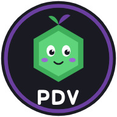

# Kaakataaan

**Kaakataaan** is based on [Katanittes by Sowtank](https://github.com/KurusuDes/CatanTestFriendos) (MIT license).
This version is developed by **Khai Vo (PDV)** and adds the Catan expansions:

- ⛵ **Seafarers:** 4 scenarios, ships, the pirate, new islands with bonus points and fog to explore.
- 🏰 **Cities & Knights:** 3 commodities, city improvements and metropolises, city walls, knights, barbarian attacks and the full set of 54 progress cards.
- 📖 Illustrated rules for each expansion.
- 🇻🇳 Vietnamese (default) and English, and a new PDV logo.

| | |
|---|---|
| 🎮 **Play** | https://khaivo-pdv.github.io/kaakataaan/ |
| 👤 **This version** | Khai Vo (PDV) — [KhaiVo-pdv](https://github.com/KhaiVo-pdv) |
| 🧩 **Original game** | Katanittes by Sowtank — [KurusuDes/CatanTestFriendos](https://github.com/KurusuDes/CatanTestFriendos) |

Run locally: `py tools/serve.py`, then open http://localhost:8123/ · Tests: `npm test`.

## License and credits

Original code and assets are under the [MIT license](LICENSE) © 2026 Sowtank ([KurusuDes/CatanTestFriendos](https://github.com/KurusuDes/CatanTestFriendos)). The expansions and the other changes in this version are by Khai Vo (PDV) and are shared under the same license. Credit to the original author is kept in [LICENSE](LICENSE), [NOTICE.md](NOTICE.md) and in the game (main menu and help screen).

**Unofficial fan project.** It isn't affiliated with, sponsored or endorsed by Catan GmbH, CATAN Studio or Kosmos. *CATAN* is a trademark of its respective owners. Third-party notices (three.js, PeerJS, fonts) are in [NOTICE.md](NOTICE.md).
